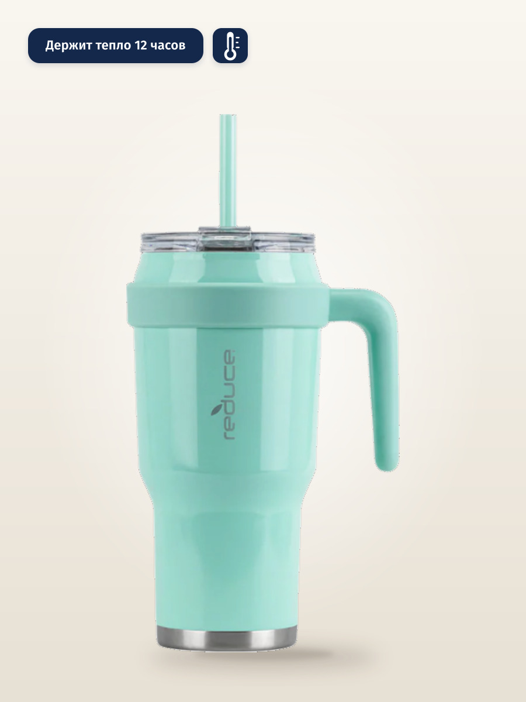

# Карточка товара «Термокружка»

Практическая работа: карточка товара **900 × 1200 px** с фотографией, векторной плашкой и иконкой термометра. Выполнены экспорты в **JPG, PNG и SVG**, проверена читаемость на масштабе 20–25 %.

## Файлы

| Файл | Что это | Размер |
|---|---|---:|
| [`export/card.jpg`](export/card.jpg) | итоговая карточка для маркетплейса, 900 × 1200, JPG q92 | 67,6 КБ |
| [`export/card.png`](export/card.png) | тот же макет в PNG (без потерь), 900 × 1200 | 186,8 КБ |
| [`export/badge.svg`](export/badge.svg) | векторная плашка 300 × 60 с текстом | 0,5 КБ |
| [`export/thermometer.svg`](export/thermometer.svg) | векторная иконка термометра 64 × 64 | 0,8 КБ |
| [`export/icon-badge.svg`](export/icon-badge.svg) | иконка в тёмно-синей плитке 60 × 60 | 0,7 КБ |
| [`card.svg`](card.svg) | редактируемый исходник макета (фото встроено) | 293 КБ |
| [`assets/photo.png`](assets/photo.png) | обработанное фото с прозрачным фоном | 109 КБ |
| [`source/thermos-source.png`](source/thermos-source.png) | исходное фото до обработки | 150 КБ |
| [`export/preview-20.png`](export/preview-20.png) | проверка читаемости на 20 % | 21 КБ |
| [`export/preview-25.png`](export/preview-25.png) | проверка читаемости на 25 % | 30 КБ |

## Что сделано

1. **Фото.** Нашёл фотографию термокружки на Wikimedia Commons (свободная лицензия, простой белый фон).
2. **Холст.** Создан фрейм 900 × 1200 px, светлый тёплый фон с мягким градиентом. Фото по центру, занимает около 77 % высоты кадра.
3. **Обработка.** Фото обрезано по контуру, белый фон удалён (прозрачность), слегка повышены яркость/контраст и резкость. Под кружкой нарисована мягкая тень.
4. **Векторные элементы.** Плашка: прямоугольник 300 × 60, скругление 20, заливка `#14284B`, белый текст 22 px «Держит тепло 12 часов». Иконка термометра собрана из прямоугольников и окружностей и размещена в плитке 60 × 60 рядом с плашкой. Плашка и иконка — в левом верхнем углу.
5. **Экспорт.** Фрейм выгружен в JPG и PNG, плашка и иконка — отдельно в SVG. Читаемость проверена на 20 % и 25 % (файлы `preview-20.png`, `preview-25.png`).

## JPG vs PNG

| Параметр | JPG | PNG |
|---|---|---|
| Размер файла | **67,6 КБ** | 186,8 КБ |
| Разрешение | 900 × 1200 | 900 × 1200 |
| Сжатие | с потерями | без потерь |
| Прозрачность | нет | есть |
| Для чего | фото для карточки/маркетплейса | исходник, графика с прозрачностью |

JPG получился примерно **в 2,8 раза легче** PNG при том же разрешении. На фотографии разница почти незаметна, а для загрузки на маркетплейс важен вес файла.

## Ответ на вопрос

**Почему фото — растровое, а плашка и иконка — векторные?**

Фотография — это реальный объект со сложными непрерывными переходами цвета, бликами, тенями и текстурой. Такую картинку описывают миллионами пикселей, и растровые форматы (JPG, PNG) хранят цвет каждого пикселя. Поэтому фото — растровое.

Плашка и иконка состоят из простых геометрических форм: скруглённого прямоугольника, текста, окружностей и линий. Их можно задать математическими путями, а не пикселями. SVG хранит именно команды построения фигур, поэтому такая графика остаётся идеально чёткой при любом увеличении, весит килобайты и легко редактируется (меняется цвет, радиус, размер без потери качества).

**Почему для карточки выбран JPG?**

Потому что основное содержимое карточки — фотография с плавными градиентами. JPG хорошо сжимает именно такие изображения, даёт небольшой вес (67,6 КБ против 186,8 КБ у PNG), не требует прозрачности и поддерживается всеми маркетплейсами. PNG здесь был бы тяжелее без видимого выигрыша в качестве, а SVG для фотографии не подходит.

## Источник фото и лицензия

- Фото: **«Reduce Drinkware Cold1 Tumbler»**, автор **Williamsplex**, [Wikimedia Commons](https://commons.wikimedia.org/wiki/File:Reduce_Drinkware_Cold1_Tumbler.png), лицензия **CC BY-SA 4.0**.
- Работа распространяется на условиях **CC BY-SA 4.0** (подробнее — в [LICENSE.md](LICENSE.md)). При повторном использовании нужна атрибуция автора фото.

## Как открыть и отредактировать

- `card.svg` можно открыть в браузере, Inkscape или перетащить в Figma — это полностью редактируемый макет (фото встроено в файл).
- Пересобрать растровые экспорты: `python3 compose.py && rsvg-convert -w 900 -h 1200 card.svg -o export/card.png`.
- Плашка и иконка лежат отдельными SVG — их можно вставлять в другие макеты.
